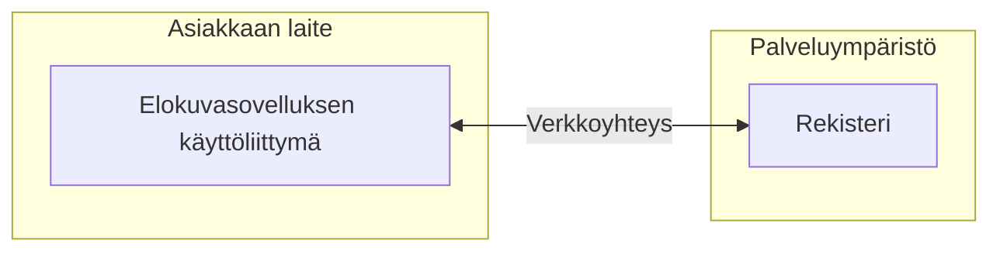
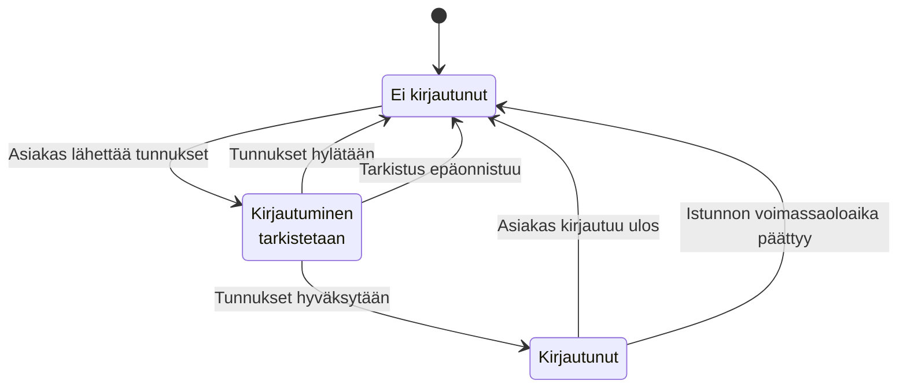

# Tekninen määrittely
## Elokuvanharrastajien ryhmäsovellus

### 1. Yleiskuvaus
Verkkosovellus, jossa käyttäjät voivat muodostaa ryhmiä, jakaa ja arvostella elokuvia (julkisesti tai ryhmän sisäisesti), keskustella sekä ylläpitää toivelistoja. Sovellus toimii myös ilman kirjautumista (rajoitetusti).

### 2. Tekniset osat
- **Frontend:** React  
- **Backend:** Express  
- **Tietokanta:** PostgreSQL  
- **Versionhallinta:** GitHub  
- **Hosting:** Azure (App Service / Container Apps + Azure Database for PostgreSQL)

### 3. Arkkitehtuuri
- **Frontend (React):** Käyttöliittymä, haku, kirjautuminen, ryhmä- ja elokuvanäkymät. Responsiivinen.
- **Backend (Express):** REST API. Käsittelee autentikoinnin, ryhmät, arvostelut, listat, keskustelut ja haun.
- **Tietokanta (PostgreSQL):** Käyttäjät, ryhmät, elokuvat, arvostelut, listat, viestit.
- **Ulkoiset palvelut:** TMDB (elokuvatiedot), Tulevat elokuvat (esim. Finnkino).
- **Azure + GitHub:** Hosting ja CI/CD.

### 4. Tärkeimmät toiminnallisuudet
- Etusivu elokuvilla + monipuolinen haku (ehdotukset)
- Ryhmien luonti, ylläpito ja jäsenhyväksyntä
- Arvostelut (1–5 tähteä + teksti) julkisesti tai ryhmässä
- Toivelistat ja klassikkolistat (jaettavissa linkillä)
- Keskustelu ryhmässä
- Kirjautuminen / rekisteröityminen (käyttäjätunnus + salasana)
- Törkyviestien moderointi
- Suomenkielinen käyttöliittymä (Enkku/Ruotsi ehkä)

### 5. Tietoturva
- Ryhmien yksityisyys ja jäsenhyväksyntä
- Perus-input-validointi ja suojaus injectionia vastaan???

### 6. Ulkoiset integraatiot
- **TMDB API:** Elokuvien perustiedot ja haku
- **Finnkino API** (ehkä): Teatteritarjonta

**KIRJAUTUMINEN**

